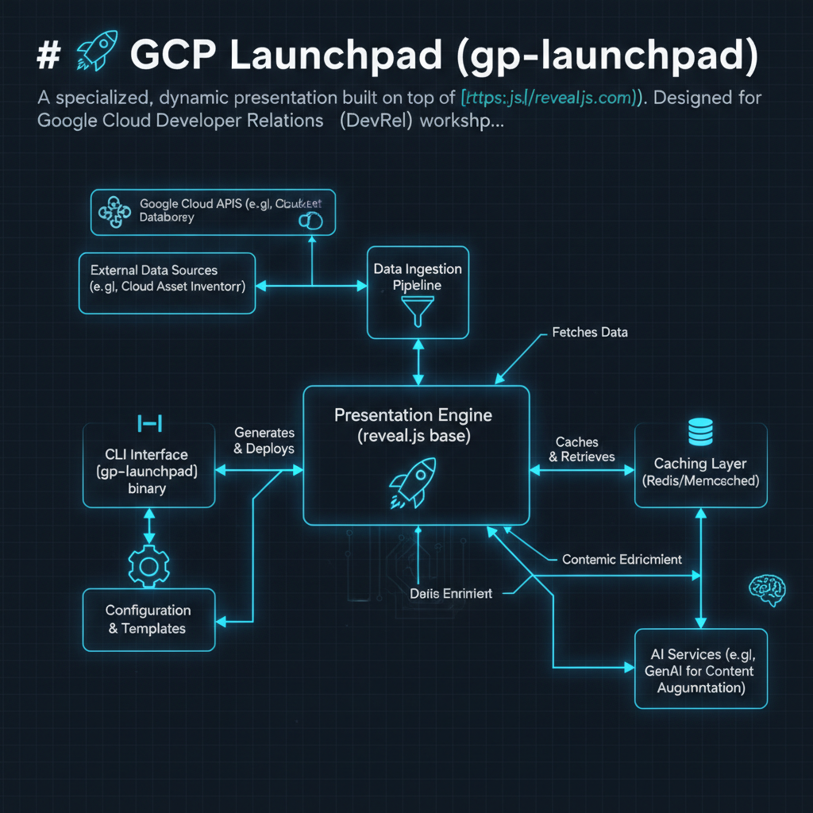
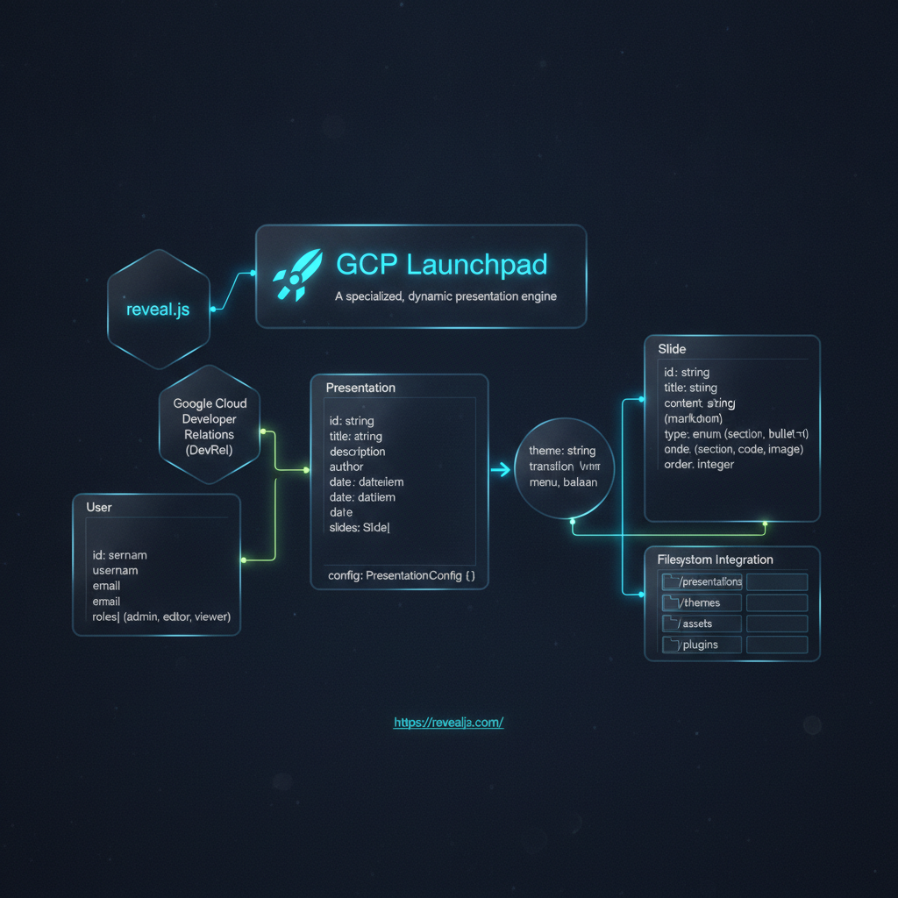

# 🚀 GCP Launchpad (`gcp-launchpad`)

A specialized, dynamic presentation engine built on top of [reveal.js](https://revealjs.com/). Designed for **Google Cloud Developer Relations (DevRel)** workshops, it delivers onboarding collateral and automates the distribution of Google Cloud Platform (GCP) trial credits via the **GCP Onramp** program (`trygcp.dev`).

---

## 🎯 Purpose & Key Features

* **Dynamic Workshop Decks**: Customizes slides on the fly per event/location using URL query parameters (`?onramp_url=`, `?location=`, `?emoji=`, `?show_workshop=`) or `data-onramp-url` attributes on the `<body>` element.
* **On-the-Fly Credit Redemption**: Automatically generates scannable QR codes (`qrcodejs`) and dynamic link indicators showing whether a workshop credit link is active or missing.
* **Multi-Topic Agendas**: Covers GCP Credit Onramp, the ADK/Agent workshop (*Building a Simple Travel Agent*), Google AI Studio Gemini API Key generation, and `@google/gemini-cli` setup.

---

## 📂 Codebase Structure

* **`onramp-images/`**: The primary visual slide deck. Uses rendered slide imagery (`images/milano-pages/`) combined with dynamic HTML/CSS overlays, a responsive Google-branded navigation hub, and dynamic QR codes for credits and presentation URLs.
* **`onramp-new/`**: A structured, semantic HTML/text implementation of the presentation, providing live code blocks and step-by-step agent instructions.
* **`docs/`**: Project documentation:
  * `USER_MANUAL.md`: Detailed usage guide for event parameters and query strings.
  * `WHY_ENV_WONT_WORK.md`: Architectural rationale for runtime DOM injection over build-time environment variable injection.
  * `sumaron/`: Automated security, architectural, and prioritized TODO audits.
* **`rag/`**: Prototyping materials and canvas experiment decks (e.g., `rag/gemini-canvas/index.html`).
* **Root & `rusko/`**: The underlying Reveal.js v5.2.1 framework files, build pipeline (Gulp, Rollup, Babel, Sass), and upstream presentation demos.

---

## ⚙️ Key Configuration & Scripts

* **`package.json`**:
  * `npm run start` / `gulp serve`: Runs the default presentation server.
  * `npm run start-images`: Launches the image-based presentation on a dedicated port.
  * `npm run build`: Bundles Reveal.js distribution assets and CSS themes.
* **`CHANGELOG.md`**: Tracks presentation versions (currently `v0.1.8`), detailing QR code improvements, menu enhancements, and the deprecation of broken Netlify deployment endpoints.
* **`GEMINI.md`**: Context documentation detailing requirements, swimlanes, and query parameter specifications for DevRel proctors.

---

## 🌐 Deployment & Hosting

* **Target Hosting**: Static GitHub Pages deployments:
  * Text/DOM version: `https://palladius.github.io/gcp-launchpad/`
  * Visual/Images version: `https://palladius.github.io/gcp-launchpad-images/`
* **Automated CI/CD**: Managed via GitHub Actions workflows deploying static `_site` builds.

---

## 🗺️ Architecture & Code Structure Visuals

| Architecture Diagram | Code Structure & E/R Diagram |
| :---: | :---: |
|  |  |
